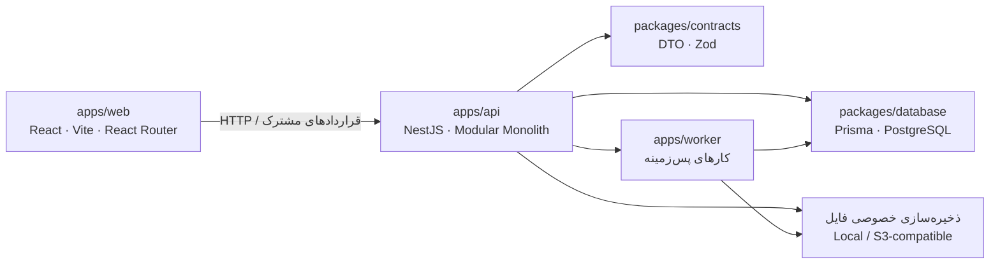

<div dir="rtl" align="right">

<h1 align="center">TStaff</h1>
<p align="center"><strong>سامانهٔ مدیریت شبکهٔ پژوهشگران</strong></p>
<p align="center">از پذیرش متقاضی تا راهبری پژوهش و تبدیل یافته‌ها به سناریو</p>

<p align="center">
  <a href="https://github.com/ManaInstituteDev/TStaff/actions/workflows/ci.yml"></a>
  
  
  
</p>

<p align="center">
  <a href="#-معرفی">معرفی</a> ·
  <a href="#-قابلیتهای-اصلی">قابلیت‌ها</a> ·
  <a href="#-معماری-در-یک-نگاه">معماری</a> ·
  <a href="#-شروع-سریع">شروع سریع</a> ·
  <a href="#-کنترل-کیفیت">کیفیت</a> ·
  <a href="#-استقرار">استقرار</a>
</p>

</div>

---

## 🔎 معرفی

TStaff یک سامانهٔ فارسی برای پذیرش متقاضیان، راهبری پژوهشگران و مدیریت چرخهٔ پژوهش است. هستهٔ محصول بر گردش علمی چهارمرحله‌ای **منابع، تبیین، تجویز و سناریو** و پیگیری نقش‌محور پرونده‌ها بنا شده است. کد در قالب یک monorepo با معماری **Modular Monolith** سازمان‌دهی شده است.

## ✨ قابلیت‌های اصلی

| 🧭 گردش پژوهش                                                           | 👥 پذیرش و راهبری                                          | 🔐 قواعد محصول                                                    |
| ----------------------------------------------------------------------- | ---------------------------------------------------------- | ----------------------------------------------------------------- |
| مراحل منابع، تبیین، تجویز و سناریو با تاریخچهٔ نسخه‌دار                 | پروندهٔ متقاضی تا پذیرش نهایی مستقل از حساب کاربری است     | دسترسی‌ها در سمت سرور کنترل می‌شوند                               |
| مسیر مستقل و قابل اشتراک برای صفحه‌ها و پرونده‌ها                       | مدیران علمی اصلی و همکار در پژوهش اختیار داوری برابر دارند | هر منبع حداکثر یک مصاحبه دارد                                     |
| بازگشت مرحله بدون حذف تاریخچه؛ خروجی‌های وابسته نیازمند بازبینی می‌شوند | کارتابل برای پیگیری وضعیت پرونده‌ها و اقدام‌های علمی       | سن فقط عدد صحیح مثبت است؛ تصمیم همزمان با کنترل نسخه انجام می‌شود |

> **محدودهٔ MVP:** ورود با نام کاربری/شمارهٔ همراه و گذرواژه انجام می‌شود. OTP پیامکی، کنشگری، هدایت تحصیلی، تالار عمومی، پنل مسئله‌پژوه و اکسپلور عمومی بانک سناریو خارج از این محدوده‌اند.

## 🧱 معماری در یک نگاه



| مسیر                 | مسئولیت                                                      |
| -------------------- | ------------------------------------------------------------ |
| `apps/web`           | رابط فارسی React، Vite، React Router و Tailwind              |
| `apps/api`           | API مبتنی بر NestJS، ماژول‌های دامنه و کنترل دسترسی سمت سرور |
| `apps/worker`        | پردازش رویدادها و کارهای نگهداری                             |
| `packages/contracts` | DTOها، قراردادهای مشترک و اعتبارسنجی Zod                     |
| `packages/database`  | مدل Prisma و migrationهای PostgreSQL                         |
| `infra/compose`      | PostgreSQL، MinIO و ClamAV برای توسعهٔ محلی                  |

## 🚀 شروع سریع

### پیش‌نیازها

- Node.js نسخهٔ `20.18` یا بالاتر
- pnpm نسخهٔ `9.15`
- Docker Compose

برای استفاده از API و فایل‌ها، PostgreSQL و ClamAV لازم است؛ MinIO آداپتور S3 محلی را فراهم می‌کند.

### اجرا

```bash
cp .env.example .env
pnpm install --frozen-lockfile
docker compose -f infra/compose/compose.dev.yml up -d
pnpm db:generate
pnpm --filter @tstaff/database prisma migrate deploy
pnpm build
pnpm dev
```

در PowerShell، به‌جای خط اول اجرا کنید:

```powershell
Copy-Item .env.example .env
```

پس از اجرا، آدرس وب در خروجی Vite نمایش داده می‌شود. API به‌صورت پیش‌فرض در `http://localhost:4000/api/v1` و مستندات Swagger در `http://localhost:4000/api/docs` در دسترس‌اند. برای اجرای API با تنظیمات فایل محیط پس از build:

```bash
node --env-file=.env apps/api/dist/main.js
```

### اتصال وب به API

حالت پیش‌فرض وب روی `localhost` و دامنه‌های `vercel.app` نمایشی است و داده‌ها را در مرورگر نگه می‌دارد. برای اتصال به API واقعی، این متغیرها را در محیط Vite تنظیم کنید:

```env
VITE_DEMO_MODE=false
VITE_API_URL=http://localhost:4000/api/v1
```

جزئیات و محدودیت‌ها: [راهنمای داده‌های نمایشی](Docs/07-quality/vercel-demo-seed.md).

> اسکریپت `scripts/seed-data.mjs` حساب‌های آزمایشی با گذرواژهٔ ثابت می‌سازد. آن را فقط پس از build و روی دیتابیس توسعهٔ جدا اجرا کنید؛ برای دادهٔ عملیاتی مناسب نیست.

## ✅ کنترل کیفیت

```bash
pnpm test:boundaries
pnpm security:audit
pnpm typecheck
pnpm test
pnpm build
```

GitHub Actions همین کنترل‌ها را پس از نصب وابستگی‌ها، تولید Prisma Client و build بسته‌های database و contracts اجرا می‌کند. آزمون‌های API عمدتاً از repositoryهای ساختگی استفاده می‌کنند؛ بنابراین جایگزین آزمون migration، قیود PostgreSQL و بازیابی پشتیبان نیستند. دستور `pnpm lint` فعلاً در چند بسته placeholder است.

## ☁️ استقرار

`vercel.json` وب را به‌شکل فایل‌های استاتیک build می‌کند و مسیرهای React Router را rewrite می‌کند. این پیکربندی API، worker، PostgreSQL یا فضای فایل را مستقر نمی‌کند. محیط واقعی به میزبانی جداگانهٔ API، پایگاه داده، ذخیره‌سازی خصوصی، اسکن فایل، تنظیمات CORS و پشتیبان‌گیری نیاز دارد؛ جزئیات در [راهنمای عملیات](Docs/06-operations/README.md) آمده است.

## 📚 اسناد پروژه

| موضوع               | سند                                                                                                                                                                             |
| ------------------- | ------------------------------------------------------------------------------------------------------------------------------------------------------------------------------- |
| نیازمندی‌ها و دامنه | [نیازمندی‌های محصول نسخهٔ ۱.۰](Docs/TStaff_Requirements_Final_v1.0%20%282%29.docx) · [محدودهٔ MVP](Docs/00-product/scope.md) · [ماتریس ردیابی](Docs/00-product/traceability.md) |
| معماری و API        | [معماری](Docs/01-architecture/README.md) · [API](Docs/03-api/README.md)                                                                                                         |
| داده و عملیات       | [داده](Docs/04-data/README.md) · [عملیات](Docs/06-operations/README.md)                                                                                                         |
| کیفیت و برنامه‌ریزی | [کیفیت و CI](Docs/07-quality/README.md) · [نقشهٔ راه](Docs/08-delivery/roadmap.md) · [تصمیمات معماری](Docs/adr/)                                                                |
| راهنمای مشارکت      | [AGENTS.md](AGENTS.md)                                                                                                                                                          |

<p align="center"><sub>TStaff · سامانهٔ مدیریت شبکهٔ پژوهشگران</sub></p>
